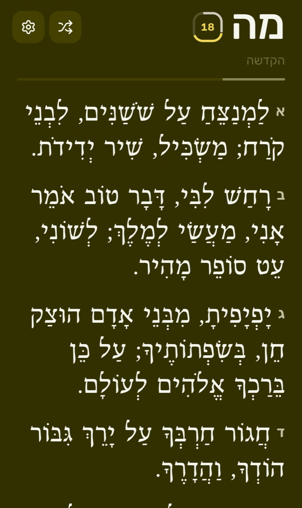
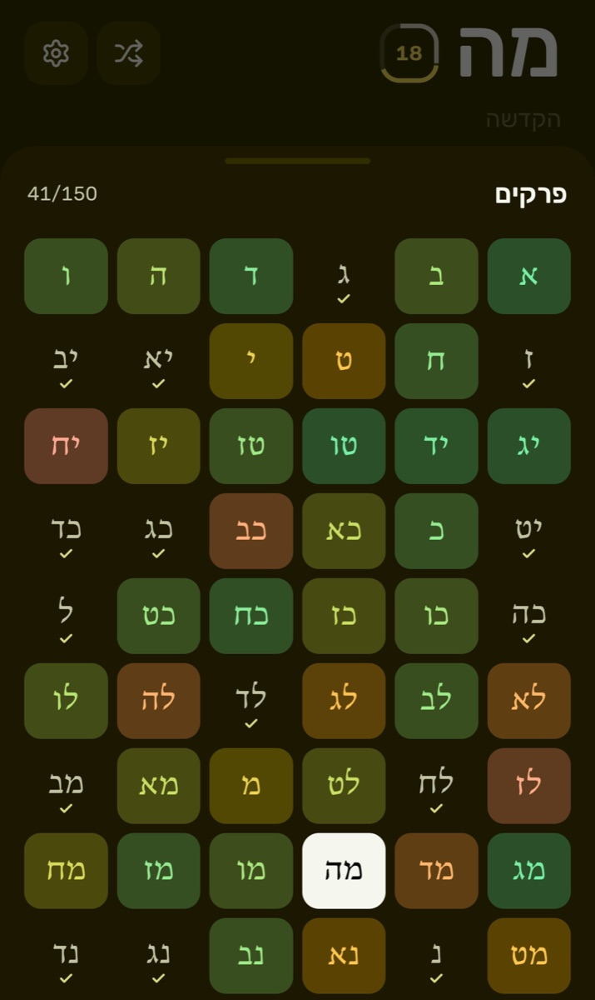

<div dir="rtl">

# תהילים
אפליקציה פשוטה לקריאת פרקי תהילים בסדר אקראי, בטלפון או במחשב.


<p align="center">
  
  &nbsp;
  
  <div align="center">https://tehilim.argamate.com</div>
</p>


## מה הפואנטה?

הפרקים בתהילים שונים מאוד באורך (מ־2 פסוקים ועד 176), אז "5 פרקים ביום" יוצא יום אחד קצר מאוד ויום אחר ארוך מאוד. לכן היעד היומי נספר בפסוקים ולא בפרקים וככה כל יום יוצא בערך אותו דבר. בוחרים יעד יומי (30, 50, 100 פסוקים או מספר אחר), ורואים כמה כבר קראת היום וכמה הפרק הנוכחי יוסיף.

אפשר גם להשתמש בה כמו ספר תהילים רגיל, להציב הקדשה בראש הפרק, שינוי גודל הטקסט (בצביטה או בהגדרות), ומסך שנשאר דלוק בזמן הקריאה.

## איך משתמשים

הכי נוח להתקין אותה כאפליקציה (PWA). ככה היא נפתחת במסך מלא ועובדת גם בלי אינטרנט:

- **אייפון:** פותחים את הקישור ב־Safari, כפתור השיתוף, ואז "הוספה למסך הבית".
- **אנדרואיד:** פותחים את הקישור ב־Chrome, בתפריט בוחרים "התקנת האפליקציה" (או "הוספה למסך הבית").
- **מחשב:** ב־Chrome או Edge יש כפתור התקנה בשורת הכתובת.

ההתקדמות נשמרת רק במכשיר שלך. אין חשבון ואין שרת, ושום דבר לא נשלח לשום מקום. זה גם אומר שאין סנכרון בין מכשירים.

## להריץ בעצמך

</div>

```bash
npm install
npm run dev     # http://localhost:5190
npm run build   # static files in dist/
npm test
```

<div dir="rtl">

אפשר להעלות את התיקייה `dist` לכל שרת של קבצים סטטיים.

נבנתה עם React, Vite ו־Tailwind. גופנים: Hadasim CLM (פרויקט Culmus) לטקסט ו־Rubik לממשק.

</div>
